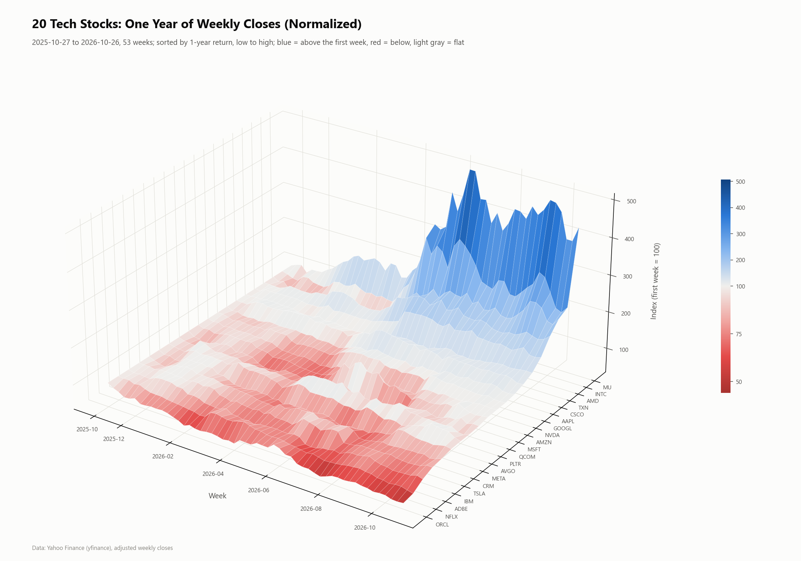
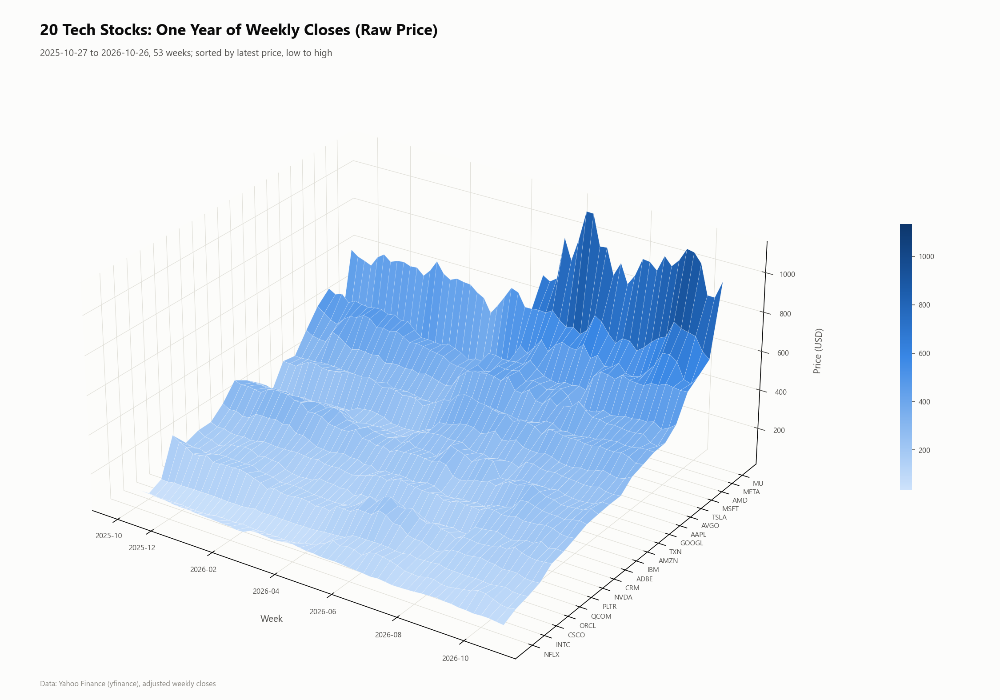
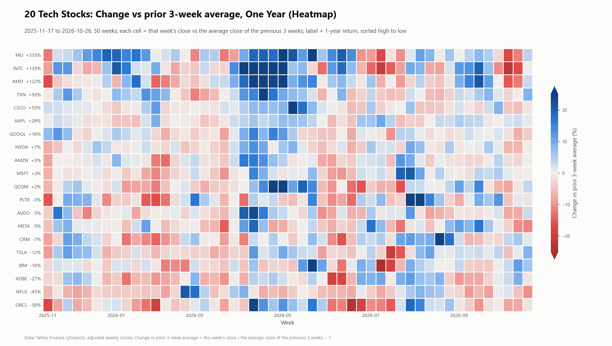
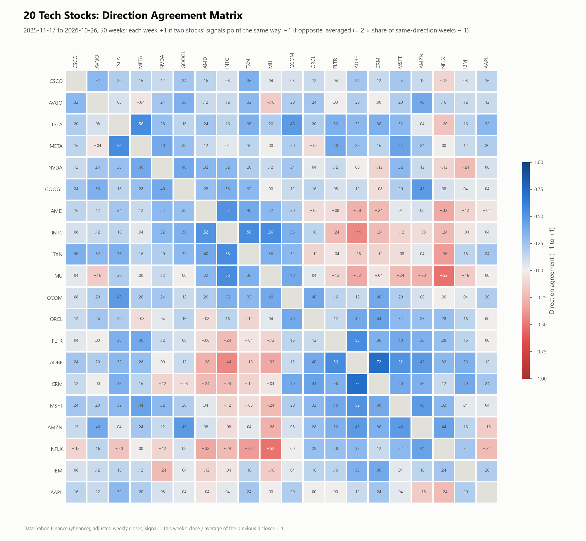
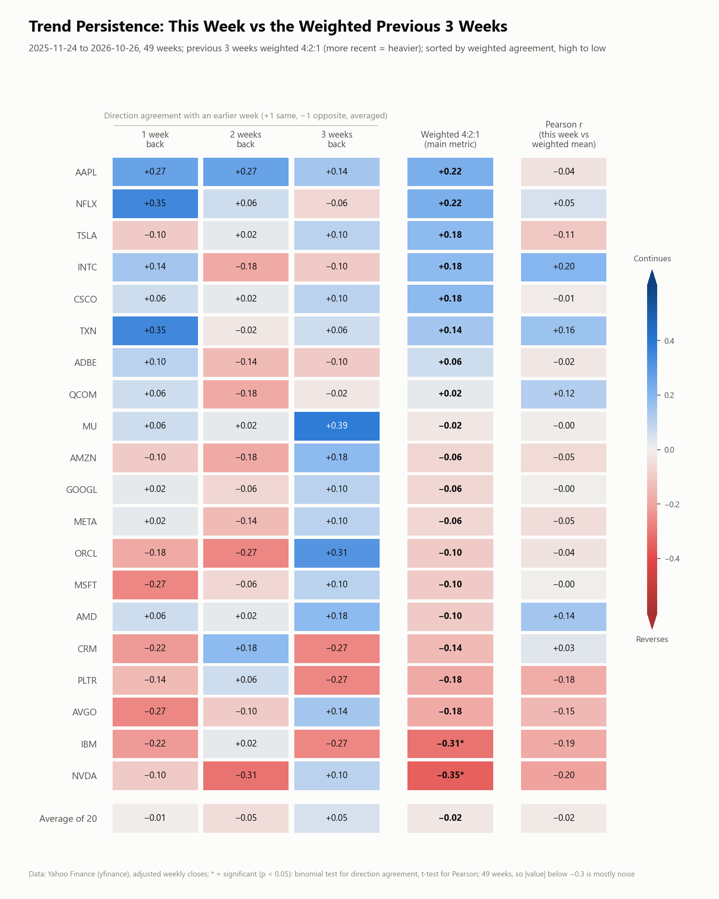
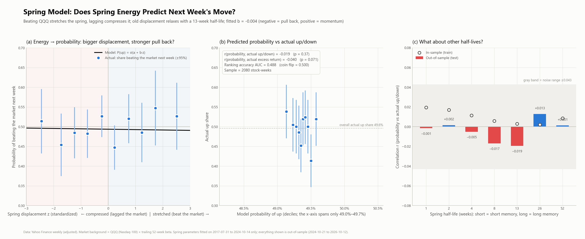
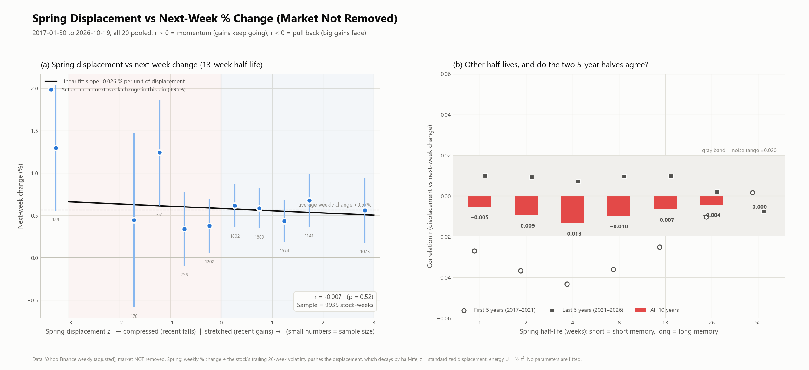
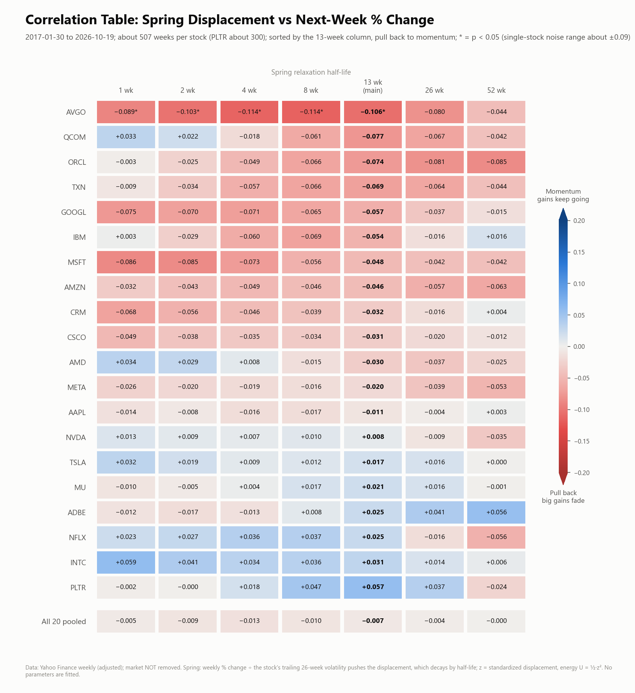

# 20 Tech Stocks, Weekly: From 3D Surfaces to a "Spring" Model

An exploratory record built one question at a time: first a 3D surface of one year of weekly prices for 20 tech stocks, then percentage changes, cross-stock direction agreement, per-stock trend persistence, and finally a "spring potential energy" model tested on whether it can predict next week's move.

**Stocks (20):** AAPL, MSFT, NVDA, GOOGL, AMZN, META, TSLA, AVGO, ORCL, AMD, CRM, ADBE, NFLX, INTC, QCOM, CSCO, IBM, TXN, MU, PLTR
**Market background:** QQQ (Nasdaq-100 ETF)
**Data:** Yahoo Finance via `yfinance`, adjusted weekly closes. One-year data covers 2025-10-27 to 2026-10-26 (the last week was not yet closed at download time); ten-year data covers 2016-10-24 to 2026-10-19.

## Disclaimer

- **AI-assisted work.** The code, figures, analysis and this README were produced with the help of Claude, an AI model by Anthropic, in a conversation with the repository owner (see the [full transcript](transcript/conversation.md)). Claude can make mistakes. Results have not been independently reviewed; please check the code and numbers before relying on them.
- **Not investment advice.** This is a statistical and visualization exercise. Nothing here is a recommendation to buy or sell any security, and past patterns do not predict future returns.
- **Data.** Prices in `data/` come from Yahoo Finance and are included only so the results can be reproduced; use and redistribution are subject to Yahoo's terms of service.

## Layout

```
src/         analysis scripts (run in numeric order)
data/        cached weekly closes (scripts read these by default)
results/     computed tables (CSV)
figures/     all charts
transcript/  the conversation that produced this repo
run_all.py   regenerate everything
```

## Running

```bash
pip install -r requirements.txt
python run_all.py            # uses the cached data, reproduces this repo exactly
python run_all.py --refresh  # downloads the latest prices
```

---

## 1. One-year weekly 3D surface · `01_surface_3d.py`

x = week, y = stock, height = price. The normalized version sets the first week to 100 and sorts by 1-year return; the raw version sorts by latest price.

| Normalized (first week = 100) | Raw price (USD) |
|---|---|
|  |  |

One-year leaders: MU +333%, INTC +135%, AMD +122%, TXN +93%. Laggards: ORCL −50%, NFLX −45%, ADBE −27%.

## 2. Three ways to measure change · `02_pct_change.py`

| Argument | Each cell = | Figures |
|---|---|---|
| `1` | this week's close / last week's close − 1 | [heatmap](figures/tech20_pct_heatmap.png) · [surface](figures/tech20_pct_surface.png) |
| `3` | this week's close / close 3 weeks earlier − 1 | [heatmap](figures/tech20_pct3w_heatmap.png) · [surface](figures/tech20_pct3w_surface.png) |
| `3 avg` | this week's close / average of the previous 3 closes − 1 | [heatmap](figures/tech20_pct3wavg_heatmap.png) · [surface](figures/tech20_pct3wavg_surface.png) |



The April–May 2026 semiconductor rally (MU, INTC, AMD, TXN, QCOM) stands out under all three measures; INTC gained +82.4% over the 3 weeks to 2026-05-04.

## 3. Direction agreement between stocks · `03_cross_stock_direction.py`

Signal = this week's close / average of the previous 3 closes − 1. For each pair of stocks, each week scores +1 if both signals point the same way and −1 if opposite; the average equals 2 × (share of same-direction weeks) − 1. Stocks are ordered by hierarchical clustering; a Pearson correlation matrix of the same signal is included for comparison.



- The average pair scores only 0.15 (about 57% of weeks in the same direction); 38 of 190 pairs are negative.
- Two blocks emerge: semiconductors (AMD, INTC, TXN, MU, QCOM) and software / internet (ORCL, PLTR, ADBE, CRM, MSFT, AMZN), mostly negative against each other. Most in sync: ADBE–CRM 0.72. Most opposed: MU–NFLX −0.52.

More: [3D surface](figures/tech20_direction_agreement_surface.png) · [Pearson comparison](figures/tech20_pearson_corr_heatmap.png)

## 4. Trend persistence within each stock · `04_persistence.py`

This week's direction vs the exponentially weighted average of the previous 3 weekly changes (weights 4:2:1, recent weeks heavier): +1 if the same (continues), −1 if opposite (reverses), averaged.



- Overall a coin flip: the 20-stock average is −0.02, and 48.9% of weeks continue.
- Only NVDA (−0.35) and IBM (−0.31) are significant, and both **reverse**. With 49 weeks, anything within ±0.3 is mostly noise.

Week by week: [tech20_persistence_weekly.png](figures/tech20_persistence_weekly.png)

## 5. The spring model

A rise stretches a spring and a fall compresses it. Each week's move pushes the spring, while old displacement relaxes exponentially with a chosen half-life (a slow, cumulative process). With standardized displacement z, the potential energy is U = ½·z² and the restoring force points against the displacement. Ten-year data comes from `05_download_10y.py`.

### 5a. Market removed, predicting direction · `06_spring_vs_market.py`

- Background: each stock's weekly return minus β × QQQ return (β from the trailing 52 weeks), divided by its own trailing 26-week volatility.
- Probability: P(beat the market next week) = σ(a + b·z), fitted on 2017–2024 only. Everything shown is **out-of-sample**, 2024-10 to 2026-10 (2,080 stock-weeks).



- At a 13-week half-life the fitted b = −0.004, so the probability only moves between 49.0% and 49.7%; r(probability, actual up/down) = −0.019 (p = 0.37), AUC = 0.488.
- Across half-lives from 1 to 52 weeks, out-of-sample r stays within ±0.02.
- By stock, only NVDA is significant (r = +0.38, p = 0.0001): it pulls back relative to the market, matching section 4. [By stock](figures/tech20_spring_per_stock.png) · [NVDA example](figures/tech20_spring_example_NVDA.png)

### 5b. Market kept, correlated with next week's % change · `07_spring_raw_pct.py`

The spring is driven by each stock's own weekly % change (÷ its own volatility), and displacement z is correlated with **next week's % change**. No parameters are fitted, so the full ten years are used (9,935 stock-weeks).





- All 20 pooled: r = −0.007 (p = 0.52) against a noise range of ±0.02; every half-life from 1 to 52 weeks lands between −0.013 and 0.
- The first five years (2017–2021) show a faint pull back (−0.03 to −0.04); the last five (2021–2026) show faint momentum (about +0.01). The sign is not stable.
- Only AVGO pulls back significantly at half-lives of 1–13 weeks (about −0.10 to −0.11). With the market kept in, NVDA's pull back disappears (+0.008).

## Conclusion

For these 20 large-cap tech stocks on weekly data, "spring energy" has essentially no predictive power for next week's direction or size, whether or not the market is removed and whatever the memory length. The few single-stock pull-back signals (NVDA relative to the market, AVGO on its own) would need longer data to confirm.
